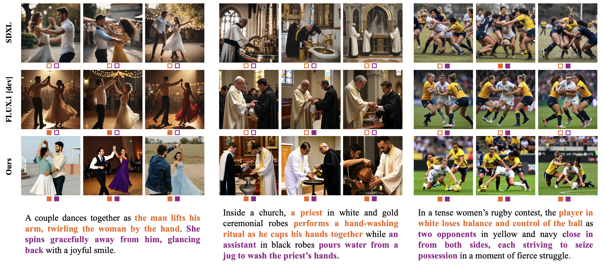

# Composing People Together: Iterative Pose-Image Generation for Multi-Person Interaction Scenes

Official PyTorch implementation for **Composing People Together: Iterative Pose-Image Generation for Multi-Person Interaction Scenes**.

<p align="center">
  <strong>Accepted to SIGGRAPH Conference Papers 2026</strong>
</p>

<p align="center">
  <a href="https://cornell-vailab.github.io/PeopleComposer/">Project Page</a> &nbsp;|&nbsp; arXiv coming soon
</p>

> **Abstract.** Despite recent progress, text-to-image models still struggle to generate semantically diverse and compositionally accurate multi-person interaction scenes, often collapsing to repetitive layouts, stereotypical poses, and poorly grounded interactions. In this work, we bridge this gap by introducing a dual pose-image representation that brings person-centric structural priors into pretrained diffusion transformers. Our model jointly predicts a 2D pose visualization image and its corresponding RGB image, enabling structure and appearance to co-evolve during learning. At its core, a cross-modal alignment scheme binds text, pose, and image representations, ensuring consistent grounding across modalities. Furthermore, we design an iterative scene construction scheme, progressively generating complex multi-human interactions while effectively decomposing the overall generation complexity. Extensive experiments demonstrate that our method substantially improves prompt alignment and scene diversity in multi-person image generation.



## Getting Started

### Environment

```bash
bash setup.sh
```

### Inference

We provide example prompts in `examples/`. To run inference:

```bash
python inference.py \
  --config configs/inference.yaml \
  --sample-json examples/example0_promptB.json \
  --output-dir outputs/example0
```

### Training

Public training data-loading instructions are being finalized. The training entry point and configuration are included for release preparation.

```bash
torchrun --nproc_per_node <number_of_gpus> --master_port <port> \
  train.py --config configs/ar_triplelora.yaml
```

Notes:

- Training is designed for FSDP and expects launch via `torchrun` due to distributed initialization at import time.
- Checkpoints are saved as full-state dicts on rank 0 under `save_dir/exp_name`; optimizer checkpoints may take longer for large models.
- The current cleaned release tree still needs public data-loading support restored before public training instructions are complete.

## Benchmark and Evaluation

We provide our full evaluation results in `eval_results/index.html`, including the benchmark generations and prompts for our model.

The DrawWaldoWorlds benchmark prompt/question file is available at `eval_results/drawwaldoworlds_benchmark.json`. The instruction prompts used for prompt tiering, structured prompt expansion, and scene-to-question decomposition are included in `instruction_prompts/`.

### Evaluation with VLM

`eval/eval_yesno_decoding.py` discovers `selected_bundle.json` files under the results root and runs GPT-based yes/no decoding for prompt types A/B/C. It writes per-run JSON outputs and a summary table under `eval_newbenchmark2/results/yesno/<backbone>/`.

```bash
python eval/eval_yesno_decoding.py \
  --results-root <YOUR_RESULTS_ROOT> \
  --annotations <YOUR_ANNOTATIONS_JSON_PATH> \
  --backbone gpt-5.2
```

Use `--prompt-types`, `--models`, `--run-filter`, or `--dry-run` to narrow the run set. The script enables human-quality limb checks by default; pass `--disable-human-quality` to skip them.

## Citation

```bibtex
@inproceedings{peng2026composing,
  title     = {Composing People Together: Iterative Pose-Image Generation for Multi-Person Interaction Scenes},
  author    = {Peng, Wenxuan and Hariharan, Bharath and Averbuch-Elor, Hadar},
  booktitle = {SIGGRAPH Conference Papers},
  year      = {2026},
  doi       = {10.1145/3799902.3811129}
}
```
